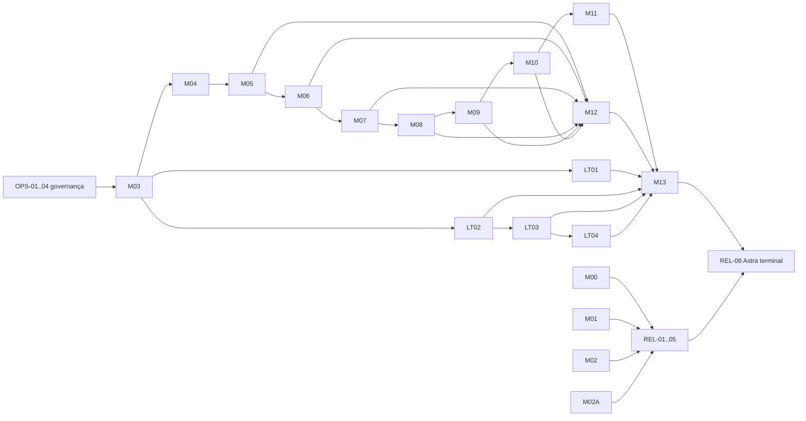

# Backlog operacional de conclusão — v4.0

**Estado:** plano executável; não é evidência e não promove gates.  
**Placar e prioridade:** `docs/STATUS-IMPLEMENTACAO-CURSO.md` é a única fonte de estado.  
**Contrato:** cada tarefa começa pela leitura de `AGENTS.md`, `CLAUDE.md`, política de fontes, status, padrão de qualidade e, quando existir, especificação e rastreabilidade do item. Nunca alterar `PROGRESSO.md` na produção editorial.

O catálogo é materializado, sem interpretação manual, por `python3 tools/backlog_tasks.py --task M03-B02-L` ou `--json`. Há **128 blocos planejados**, cada qual com três folhas atômicas (`C`, `L`, `D`): **384 folhas**. Com G0, editorial, governança e release, o gerador produz o total exibido por `python3 tools/backlog_tasks.py`. `python3 tools/validate_backlog.py` percorre o DAG expandido; uma tarefa bloqueada continua bloqueadora da release e não equivale a conclusão.

## Como executar este backlog

Uma tarefa é pequena o bastante para uma única intervenção de **GPT-5.6 Terra, esforço low**. O executor só altera os caminhos indicados, preserva mudanças alheias, registra comandos e saídas reais na rastreabilidade e pede revisão Terra. **GPT-5.6 Sol low** é reservado a integração de CI, Docker, PostgreSQL, segurança e release quando Terra não puder resolver o bloqueio em uma tentativa. **GPT-6 Astra não participa da autoria, do planejamento ou de revisões intermediárias:** é a revisão terminal `REL-06`, somente após todas as tarefas anteriores concluídas e todos os bloqueios resolvidos.

Para cada `MOD-*`, aplicar o mesmo corte em tarefas atômicas:

1. `-S` (escopo): especificação, fontes por afirmação mutável, matriz e rastreabilidade; aprova apenas G0.
2. `-C` (conteúdo): HTML autossuficiente, sem pressupor stack, práticas intermediárias convertidas em leitura aplicada e checkpoint por cenário; candidato a G1/G3.
3. `-L` (laboratório): referência instalável em `lab/`, cópia temporária marcada, fixtures locais, positivos/negativos, cleanup e evidência gerada; candidato a G2/G4/G5.
4. `-E` (editorial): fontes/âncoras, HTML, acessibilidade, 390 px, impressão e revisão visual; candidato a G6.

Cada executor anexa à rastreabilidade: arquivos mudados, IDs de cenário cobertos, versão/ambiente, comandos, saída sem segredos, limitações e gate candidato. Não declara êxito quando Docker, rede, hardware ou conta faltarem.

## Grafo de dependências

`M02A` pode ocorrer após M11, antes de M12, porque fornece fundamentos de engenharia não cobertos pela cadeia M03–M11. M12 e M13 não são liberados para estudo até os gates completos; o diagrama mostra dependência curricular/técnica, não autorização para saltar a fila do status.

## Fundações e automação

| ID | Dependência | Entrada e saída | Aceite objetivo / verificação |
|---|---|---|---|
| OPS-01 | — | `tools/check_course.py`, `tools/test_check_course.py` → adicionar manifesto de cobertura editorial em `docs/` e teste para ele | Todo M00–M13 e LT01–LT04 aparece uma vez; o teste falha para item, ID ou dependência ausente/cíclica. `python3 -m unittest discover -s tools -p 'test_*.py'`. |
| OPS-02 | OPS-01 | política, specs, rastreabilidades → registro de fontes com data, risco, bloco e afirmação | Revalidar somente fontes de alto risco vencidas; conservar leituras obrigatórias e separar evidência econômica (método, população, data, limite) de regra técnica. Nenhum ranking ou fornecedor vira requisito. Verificador de links é auxiliar; checagem HTTP documenta falha de rede. |
| OPS-03 | OPS-01 | `tools/` e `README.md` → comando canônico de qualidade por lab e matriz de capacidades locais | Detecta pré-requisitos (`uv`, Python 3.14, Docker/Compose, Git, RAM/GPU quando aplicável) antes de executar. Falta vira `BLOQUEADO`, jamais `skip` verde. |
| OPS-04 | OPS-01 | HTMLs e `tools/check_course.py` → validação de mapa, links, headings únicos, fonte e rótulos de exemplo | Acrescenta checagem de correspondência seção→lab/checkpoint e relatório contextual de clocks/stack; não substitui revisão humana/a11y. Testes cobrem falso positivo e falha real. |
| OPS-05 | OPS-03 | `.github/workflows/` inexistente, scripts locais → pipeline versionado e equivalente local | PR executa verificador editorial e gates offline descobertos; jobs Docker ficam explícitos e não são marcados aprovados sem runner. Actions fixadas por SHA e permissões mínimas. |

## Módulos já produzidos: revalidação sem reescrita indevida

| ID | Dependência | Entrada e saída | Aceite objetivo / verificação |
|---|---|---|---|
| M00-E | OPS-04 | `modulos/M00-ferramental/M00.html`, rastreabilidade → QA G6 da revisão | Navegação, foco, contraste, leitura a 390 px e impressão observados via `localhost`; fontes/links anotados. Não reexecutar ou promover G2 sem mudança no lab. |
| M01-E | OPS-04 | M01 HTML/rastreabilidade → G6 revalidado | Confirma que explicações Python pré-M02, ritmo livre e laboratório final sobrevivem à revisão; QA visual e `tools/check_course.py` focal. |
| M02-E | OPS-04 | M02 HTML, README/rastreabilidade → G6 e checkpoint coerentes | Confirma ausência de comparações como pré-requisito, rotula exemplos e mantém AT-001..038 históricos separados da nova inspeção. |
| M02A-C07 | M11-C | M02A spec/trace, `M02A.html` → B07–B10 e checkpoint correspondente | Cobrir falha parcial, teste, ameaça, telemetria/SLO com N1–N4 e cenários AT-023..045; fontes por bloco; não promover G2 sem lab. |
| M02A-L07 | M02A-C07 | `M02A.../lab/python` → oráculos para B07–B10 | Fake/fixture determinístico prova falha, mutante, ameaça e trace sem rede; `uv run ruff check .`, `uv run mypy .`, `uv run pytest`; saída real em evidência. |
| M02A-C11 | M02A-L07 | M02A HTML/spec → B11–B15, incluindo API/CLI Python | Medição com amostras brutas, modernização/reversão, governança e compatibilidade API/CLI; AT-006/010/022/040 só passam com corpus diferencial. |
| M02A-L11 | M02A-C11 | lab M02A → wheel instalado fora do checkout, CLI e API | Prova overload/timeout/cancelamento e cleanup; `uv build`, instalar wheel em cópia marcada, comandos de qualidade; nenhum adapter .NET é criado. |
| M02A-E | M02A-L11, OPS-04 | M02A HTML/trace → G3–G6 candidato | Checkpoint/rubrica por todos os 60 AT, fontes e QA visual/print; gate permanece pendente até revisão do orquestrador. |

## Cadeia curricular M03–M11

| ID | Dep. | Entrada → saída delimitada | Aceite e verificação real |
|---|---|---|---|
| M03-C02 | OPS-02 | `M03.html`, spec/trace → B02–B04 e checkpoint | Sessão, migration, concorrência, arquitetura e AT-005..016 explicados antes da ferramenta; fontes citadas por bloco. |
| M03-L02 | M03-C02, OPS-03 | criar `M03.../lab/` → serviço `link-shortener`, Alembic, Postgres, testes | Cópia temporária; migration upgrade/downgrade, constraint/corrida, ASGI, Testcontainers; Ruff/mypy/pytest e Docker quando disponível. |
| M03-C05 | M03-L02 | M03 HTML → B05–B08 | Imagem, Compose, CI, operação local e AT-017..032; deploy externo permanece opcional. |
| M03-E | M03-C05, OPS-05 | M03 lab/HTML/trace → todos G1–G6 candidatos | Workflow equivalente ao comando local; release sem segredo; QA 390px/print; Docker ausente bloqueia G2/G5. |
| M04-S | M03-E | criar `docs/especificacoes/M04-ESPECIFICACAO.md`, `modulos/M04.../RASTREABILIDADE.md` | Define blocos existentes: discovery, requisitos, ADR, C4, Mermaid, fitness functions e handoff; ATs, fontes, lab local e integração Cartógrafo; G0 apenas. |
| M04-C/L/E | M04-S | HTML/README + `lab/` para ADR/C4/decisão rastreável | Fitness function e detector de drift executáveis; diagrama acessível com alternativa textual; qualidade local, checkpoint e G6. |
| M05-S | M04-C/L/E | spec/trace M05 | Define gateway, normalização, portas/adapters, cache, retry/timeout, custo e relatório; fake e duas implementações sem rede obrigatória; G0. |
| M05-C/L/E | M05-S | M05 HTML/README + lab gateway | Contrato único para providers, fake determinístico, cache e falha; medição de custo/latência rotulada com ambiente/amostras; ATs, checkpoint, CI e G6. |
| M06-S | M05-C/L/E | spec/trace M06 | Define datasets versionados, graders, calibração humana, estatística, OTel sanitizado e gate; limites de LLM-as-judge e fonte dos dados; G0. |
| M06-C/L/E | M06-S | M06 HTML/README + lab eval runner | Seis categorias, casos negativos, intervalo/variância e relatório reproduzível; gate local/CI não usa credencial; tracing sem PII; G1–G6 candidatos. |
| M07-S | M06-C/L/E | spec/trace M07 | Define corpus de código Python com licença/origem, chunking, retrieval ACL-first, abstenção, hybrid/rerank e evals; G0. |
| M07-C/L/E | M07-S | M07 HTML/README + lab RAG | Corpus versionado, índice local, teste de vazamento cross-tenant, recall separado de geração, samples de benchmark; fonte/modelo/ambiente declarados. |
| M08-S | M07-C/L/E | spec/trace M08 | Define workflow/agente, contrato de tool, orçamento, parada, memória, multiagente e adapters; frameworks como adapters; G0. |
| M08-C/L/E | M08-S | M08 HTML/README + lab investigador | Avalia escolha workflow/agente, tool schema, budget, loop infinito, timeout e adversarial prompt; fake sem rede e checkpoint por cenário. |
| M09-S | M08-C/L/E | spec/trace M09 | Define MCP/A2A, transporte, descoberta, identidade/confiança, versão, autorização e interoperabilidade; APIs externas opcionais; G0. |
| M09-C/L/E | M09-S | M09 HTML/README + lab protocol adapters | Servidor/cliente in-memory, schema e contrato entre duas implementações; trata conteúdo como dado; prova timeout/cancelamento/negação de capability. |
| M10-S | M09-C/L/E | spec/trace M10 | Define durabilidade, restart, HITL, grafo determinístico, consulta, memória temporal e métricas arquiteturais; escolhas AGE/Neo4j/tabelas como adapters; G0. |
| M10-C/L/E | M10-S | M10 HTML/README + lab workflow/grafo | Kill/restart não duplica efeito, aprovação vinculada, corpus de grafo e consultas reproduzíveis, invalidação por commit; DB real se requisito da spec. |
| M11-S | M10-C/L/E | spec/trace M11 | Reconstrói B01–B08: tensor/atenção, treinamento, serving, modelos locais, quantização, benchmark e integração gateway; CPU obrigatório, GPU opcional; G0. |
| M11-C/L/E | M11-S | M11 HTML + companion + lab instalável | Implementa atenção comparada ao framework, dados/licenças, seeds, amostras brutas e diagnóstico de OOM/qualidade; não publica números sem execução. |

## Laboratórios transversais

| ID | Dep. | Entrada → saída delimitada | Aceite e verificação real |
|---|---|---|---|
| LT01-C/L/E | M03-E, OPS-03 | spec LT01 → `modulos/LT01-runtime-linux-redes/` HTML, lab, trace | Processo/sinais, FS, DNS/TCP/TLS, pools e incidente; fault injection com cleanup comprovado. Marcar Windows/WSL/Linux e não fingir sinal POSIX em Windows. |
| LT02-C/L/E | LT01-C/L/E | spec LT02 → diretório LT02 | Broker/Postgres em sandbox, outbox/inbox, crash/retry/DLQ/PITR; cada falha da agenda prova invariante e restauração. Docker é bloqueio explícito. |
| LT03-C/L/E | LT02-C/L/E | spec LT03 → diretório LT03 | OCI, Kubernetes local, IaC/GitOps/canary; recursos só sandbox nomeado e destroy guard testado. Sem cloud/conta obrigatória. |
| LT04-C/L/E | LT03-C/L/E, M12-E | spec LT04 → diretório LT04 e dossiê | Contract/property/mutation, performance/resiliência, SBOM/provenance, policy, governança e go/no-go; dados de avaliação e assinatura verificáveis. |

## M12, M13 e release

| ID | Dep. | Entrada → saída delimitada | Aceite e verificação real |
|---|---|---|---|
| M12-L | M05-C/L/E, M06-C/L/E, M07-C/L/E, M08-C/L/E, M09-C/L/E, M10-C/L/E, LT02-C/L/E | lab M12/capstone → PostgreSQL E2E, game day, evidência | RLS/pool, idempotência/crash, billing fake/reconciliação, SLO/burn alert e incidente executados; Docker obrigatório, sem `skip` promotor. |
| M12-C/E | M12-L | M12 HTML/fontes/trace → gates completos candidatos | Cada bloco 1–9 liga controle a ameaça/teste/evidência; G6 visual/print e fontes revalidadas. |
| M13-C01 | M11-C/L/E, M12-C/E, LT01-C/L/E, LT02-C/L/E, LT03-C/L/E, LT04-C/L/E | capstone + M13 spec/trace → B01–B05 | Release reproducível, ingestão, parser determinístico multi-language com corpus explicado, migrations/RLS; executa Docker/Postgres. |
| M13-C02 | M13-C01 | capstone/M13 → B06–B10 | Retrieval ACL, grafo, provider ports, workflow durável, HTTP/MCP/A2A contracts; evals e casos negativos integrados. |
| M13-C03 | M13-C02 | capstone/M13 → B11–B15 | Regressão, segurança, billing, observabilidade, onboarding acessível; release dossier não contém PII/segredos. |
| M13-C04 | M13-C03 | capstone/M13 → B16–B20 | Capacidade, deploy/restore/rollback, game day, piloto autorizado e defesa; piloto é bloqueio de participação humana, não dado inventado. |
| M13-E | M13-C04, OPS-05 | M13 HTML/README/trace/evidence → G0–G6 candidato | Evidência gerada, todos CAP-* rastreáveis, README reproduzível, QA visual/a11y/print; release não é publicada automaticamente. |
| REL-01 | todos `*-E`, OPS-05 | `docs/MATRIZ-RASTREABILIDADE.md`, status → auditoria de cobertura | Todo bloco, AT/CAP/LT e gate tem arquivo/evidência/estado coerente; testador do backlog e verificador editorial passam. |
| REL-02 | REL-01 | labs/capstone → execução limpa por matriz de ambiente | Executa cada gate que o ambiente suporta; produz tabela de versão/comando/saída e lista bloqueios. Não converte indisponibilidade em sucesso. |
| REL-03 | REL-02 | HTMLs → revisão de acessibilidade/visual | Teclado, landmarks, foco, contraste, 390 px e impressão em todos; alternativa textual para diagramas e tabelas grandes. |
| REL-04 | REL-03 | fontes/evidências → revisão de freshness e claims | Toda fonte de alto risco dentro de 90 dias ou marcada vencida/bloqueadora; números têm dataset, versão, parâmetros e ambiente. |
| REL-05 | REL-04 | status, release dossier → revisão Terra/Sol de integração | Dois revisores leves independentes verificam diff, gates, logs e ausência de mudanças em `PROGRESSO.md`; corrigir antes da próxima tarefa. |
| REL-06 | REL-05 | repositório completo → parecer final GPT-6 Astra | Astra revisa somente o conjunto fechado: consistência curricular, evidência, segurança, fontes e G0–G6. Achados reabrem tarefas Terra/Sol; não há promoção automática. |

## Regras de aceite transversal

- Cada conteúdo explica problema, definição, mecanismo, decisão, limite e diagnóstico. Bloco não é sessão, e nenhuma tarefa introduz relógio, diário, aquecimento ou comparação obrigatória com outra stack.
- Cada módulo novo ganha spec + trace antes do HTML. Uma tarefa `C/L/E` atualiza os dois; a mudança de estado no status ocorre somente após revisão do orquestrador.
- Laboratórios obrigatórios usam Python 3.14, `uv`, tipagem estrita, Ruff e pytest; o comando exato vem do `pyproject.toml` do lab. Rede, crédito, GPU e cloud são opcionais salvo se a especificação declarar sandbox local obrigatório.
- A prática precisa ser recuperável: cópia temporária possuída, marcador, estado inicial, comandos, saída, diagnóstico e cleanup. Nunca apagar fora do sandbox.
- Acessibilidade é parte do HTML: `lang`, landmarks, heading order, labels, foco, contraste, `prefers-reduced-motion`, impressão e alternativa para SVG/Mermaid. A inspeção automatizada sinaliza; a visual conclui G6.
- Cada fonte de produto, preço, versão, quota, suporte ou adoção é revalidada no ponto de uso. Leituras mandatórias da política permanecem; evidência de contexto econômico só contextualiza escolha e expõe método/população/limite.

## Catálogo expandido por bloco

As linhas acima são épicos de integração; a unidade que pode ser atribuída a Terra low é uma instância deste catálogo. O executor recebe **um** ID expandido, nunca `MXX-C/L/E` inteiro. As três instâncias abaixo têm ownership exclusivo e dependem da anterior; `E` continua uma tarefa do módulo porque acessibilidade e coerência só podem ser verificadas no documento completo.

| Sufixo | Ownership exclusivo | Entrada | Saída e aceite |
|---|---|---|---|
| `-C` | teoria, exemplo trabalhado e fonte do bloco | seção da especificação + IDs AT/CAP/LT indicados abaixo | HTML em `MXX.html`, com definição/mecanismo/decisão/limite, fonte datada e ponte ao arquivo do lab; nenhum comando de construção fora do laboratório final. |
| `-L` | código, fixture e oráculo do bloco | `-C` + arquitetura do lab | apenas `lab/src`, `lab/tests`, `lab/fixtures` e `lab/README`; teste positivo e negativo, cleanup e caminho de evidência. Não altera HTML nem gate. |
| `-D` | diagnóstico, checkpoint, rastreabilidade e execução | `-L` | tabela sintoma→causa→correção, rubrica por cenário, rastreabilidade de AT/CAP/LT e saída executada. Não muda o status. |

Uma instância `-L` não pode depender de serviço pago, conta, rede ou GPU. Quando o cenário exige Docker/broker/cluster, ela constrói o teste e marca a execução como bloqueada até a capacidade declarada em `OPS-03`; nunca introduz `skip` como aprovação.

| Família de IDs expandida | Blocos, temas e cenários que o executor deve cobrir | Dependência adicional |
|---|---|---|
| `M03-B01-{C,L,D}` | HTTP/OpenAPI, Problem Details, lifecycle, correlation ID; AT-001..004 | M03-L02 para implementação real da rota |
| `M03-B02-{C,L,D}` | sessão async, migration, rollback, constraint e concorrência; AT-003,005..008 | M03.1 |
| `M03-B03-{C,L,D}` | índice/EXPLAIN, JSONB, lost update, isolamento; AT-009..012 | M03-B02-L |
| `M03-B04-{C,L,D}` | domínio, aplicação, infraestrutura e import guardrail; AT-013..016 | M03-B01-L |
| `M03-B05-{C,L,D}` | imagem, usuário, contexto, Compose e health; AT-017..020 | M03-B02-L |
| `M03-B06-{C,L,D}` | ASGI, Testcontainers, estado e DB indisponível; AT-021..024 | M03-B01/02/03/04/05-L |
| `M03-B07-{C,L,D}` | CI, lock, digest, segredo e migration release; AT-025..029 | M03-B05/06-D, OPS-05 |
| `M03-B08-{C,L,D}` | operação local e diagnóstico; AT-030..032 | M03-B01..07-D |
| `M04-B01..B04-{C,L,D}` | descoberta/requisitos, Diátaxis, ADR/C4/Mermaid e fitness functions/drift; ATs nascem em M04-S e devem cobrir referência ausente, decisão incompleta, diagrama inválido e drift corrigido | M04-S; M03-E |
| `M05-B01..B07-{C,L,D}` | contrato de mensagem, portas/adapters, streaming, cache, retry/circuit, budget/custo, relatório; ATs criados em M05-S cobrem fake, stream parcial, JSON inválido, timeout e retry storm | M05-S; M04-E; M03-E |
| `M06-B01..B06-{C,L,D}` | eval, dataset, graders, prompt registry, OTel sanitizado, CI/report; ATs criados em M06-S cobrem leakage, mutante de grader, regressão de qualidade e segurança | M06-S; M05-E |
| `M07-B01..B08-{C,L,D}` | embedding, chunking, pgvector, hybrid/RRF, rerank, ACL/abstenção, eval, integração; ATs criados em M07-S cobrem corpus Python, tenant cross-leak e ablation | M07-S; M06-E; M03-E |
| `M08-B01..B08-{C,L,D}` | workflow/agente, padrões, tools, contexto, loop, memória/multiagente, framework/ADR, investigador; ATs criados em M08-S cobrem budget, parada, timeout, deny e escolha comparativa | M08-S; M07-E |
| `M09-B01..B07-{C,L,D}` | contratos MCP/A2A, transporte, descoberta, identidade, versões, tools/resources/prompts e ataques/integração; ATs criados em M09-S cobrem schema, replay, capability deny e cliente independente | M09-S; M08-E |
| `M10-B01..B10-{C,L,D}` | decisão grafo/workflow, estado, restart, HITL, extração, armazenamento, GraphRAG, memória temporal, métricas e perguntas do produto; ATs criados em M10-S cobrem crash, efeito único, provenance e medidas indefinidas | M10-S; M09-E |
| `M11-B01..B08-{C,L,D}` | fundamento, tensor/autograd, atenção, transformer, treinamento, serving, modelos locais e benchmark/tool calls; ATs criados em M11-S cobrem `zero_grad`, máscara, equivalência, seed, OOM e abstenção | M11-S; M10-E |
| `M02A-B07..B15-{C,L,D}` | falha parcial, qualidade, segurança, observabilidade, capacidade, mudança, Python avançado, API/CLI e governança; AT-023..045 e AT-006/010/022/040 no B14 | M11-E; M02A-C07/L07 conforme tema |
| `M12-B01..B09-{C,L,D}` | ameaça, conteúdo/secrets, auth, tenancy/RLS, idempotência, quota, billing, SLO e hardening; M12-AT-001..060 conforme tabela da especificação | M12-L e dependências declaradas na especificação |
| `M13-B01..B20-{C,L,D}` | contrato, reprodução, ingestão, parse, dados, RAG, grafo, provider, agente, protocolos, evals, segurança, billing, SRE, UX, capacidade, deploy, incidente, piloto e release; CAP-* correspondente em `M13-ESPECIFICACAO.md` | M13-C01..C04 e seus predecessores |
| `LT01-B01..B06-{C,L,D}` | processo, filesystem, rede, HTTP, saturação e incidente; LT01-AT-001..061 | LT01-C/L/E épico e sandbox declarado |
| `LT02-B01..B06-{C,L,D}` | falha parcial, filas, outbox, retry/saga, WAL/PITR, incidente; LT02-AT-001..061 | LT02-C/L/E e Postgres/broker |
| `LT03-B01..B06-{C,L,D}` | OCI, workloads, probes/escala, IaC, GitOps e canary; LT03-AT-001..061 | LT03-C/L/E e cluster sandbox |
| `LT04-B01..B06-{C,L,D}` | oráculos, performance/evals, supply chain, secure SDLC, governança e release; LT04-AT-001..061 | LT04-C/L/E e saídas M12/M13/LT03 |

### Validação da expansão

`OPS-01` deve materializar um manifesto derivado das especificações. Para módulos sem G0, a tarefa `MXX-S` cria primeiro os IDs AT; o validador recusa iniciar `MXX-Bnn-C` sem especificação, rastreabilidade, bloco e pelo menos um cenário. Para módulos com G0, o validador exige que todo ID do catálogo de aceitação apareça em uma instância `-C`, `-L` ou `-D`, e que nenhuma dependência aponte a ID inexistente. Assim, a economia vem do molde repetível, não da omissão de competências.

| Especificação já aprovada em G0 | Cobertura planejada obrigatória |
|---|---|
| M03 | `M03-AT-001..032` nos blocos B01..B08 |
| M02A (fatia pendente) | `M02A-AT-006,010,022,023..045` nos blocos B07..B15; B01..B06 exigem somente revalidação por M02A-E |
| M12 | `M12-AT-001..060` nos blocos B01..B09 |
| M13 | todos os 30 `CAP-*` nomeados em `M13-ESPECIFICACAO.md`, distribuídos por B01..B20 |
| LT01, LT02, LT03, LT04 | respectivamente `LT01-AT-001..061`, `LT02-AT-001..061`, `LT03-AT-001..061` e `LT04-AT-001..061`, nos seis blocos de cada LT |

## Bloqueios conhecidos e decisão operacional

**Bloqueados impedem release.** Só `PASS` obtido por comando real e revisado pode satisfazer uma folha bloqueadora; `BLOCKED` conserva a tarefa no caminho de `REL-05` e, portanto, de `REL-06`.

| Bloqueio | Itens afetados | Conduta |
|---|---|---|
| Docker/Compose indisponível | M03, M12, M13, LT02–LT03 | Produzir conteúdo/testes offline, registrar o comando que não pôde rodar e manter G2/G5 pendente. |
| Python 3.14/uv ou lock indisponível | todos os labs | Não alterar faixas/dependências para forçar execução; corrigir ambiente ou declarar bloqueio. |
| Rede, API, crédito ou modelo externo | M05–M11, M13 | Fake/recording local cobre obrigatoriedade; live test é adicional, datado e nunca representa fornecedor universal. |
| GPU/RAM insuficiente | M11 | CPU é baseline; reduzir corpus/modelo só quando a spec define o experimento equivalente; registrar limites. |
| Piloto, feedback ou revisão humana indisponível | DID-09, M13-C04 | Não inventar dados; manter o cenário pendente e preservar artefatos para execução posterior. |
